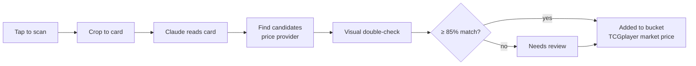

# EZScanner

> Scan large lots of Pokémon cards with a phone, get exact-version TCGplayer market prices, and track what each lot cost.


## Why I built it

I run a card repacking business. Buying a lot means pricing hundreds of cards fast, and the exact version matters: a reverse holo can be worth 10× the regular print. Off-the-shelf scanners optimize for speed; I needed accuracy I could measure, team-wide lot tracking, and a live offer calculator.

## What it does

- **Live camera scanning.** Tap to scan; keep scanning while earlier cards are identified.
- **AI identification with verification.** Claude reads the card, a card database confirms it, and a visual double-check against official card images confirms the exact version.
- **Search like Collectr.** Type "charizard 14" or "celebi sky" and pick the card from a grid, one tile per version; its TCGplayer market price is pulled when you confirm it.
- **Needs review.** Anything under 85% confidence is flagged and left out of the totals until a person confirms it.
- **Lots ("buckets").** Market value, what we paid, profit, and an offer calculator that works in % or dollars, plus an everyday calculator that can pull in the bucket's numbers.
- **Light and dark mode**, and a full-screen camera with a see-through bottom panel.
- **TCGplayer's Near Mint market price.** When a card goes into a bucket, the app reads its Near Mint Market Price live from TCGplayer through a small Supabase function. A daily copy of TCGplayer's price guide, rebuilt by GitHub Actions, powers search and scanning and is the fallback, labelled "daily".
- **Measured accuracy.** Every scan records its model and whether a person had to fix it.
- **Coming in v0.3:** a shared team database with sign-in (Supabase), with API keys moved off phones.

## How it works



More in [docs/architecture.md](docs/architecture.md).

## Results

| Method | Exact-version accuracy | Cost per 1,000 cards |
| --- | --- | --- |
| Claude Sonnet 5.5 + double-check | TBD (v0.4 benchmark) | ~$10–15 (est.) |
| Claude Haiku 5.5 | TBD | ~$0.35 (est.) |
| Free text reader | TBD | $0 |

Benchmark method: [eval/](eval/) · 100 cards across modern, vintage, reverse holo, subsets, sleeved and hard lighting.

## Project journey

This repo documents how the project was built, not just the result:

- [Devlog](docs/devlog/): one entry per work session — what I built, what broke, what I learned.
- [Decisions](docs/decisions/): why the big choices were made (AI vision over image matching, swappable price data, Supabase).
- [Roadmap](ROADMAP.md) and [Changelog](CHANGELOG.md), mirrored as GitHub milestones and releases.

## Tech

Vanilla JavaScript modules (no build step) on GitHub Pages · IndexedDB today, Supabase (Postgres, auth, row-level security, Edge Functions) in v0.3 · Claude vision API · TCGplayer price guide via tcgcsv.com, rebuilt daily by GitHub Actions · Tesseract.js fallback · Vitest + GitHub Actions.

## Run it locally

```bash
npm install
npm test             # unit tests
npm run prices       # download TCGplayer prices for every set (~2–3 min; once a day is plenty)
npx serve .          # open http://localhost:3000 (the laptop webcam works on localhost)
```

Setting up your own team database: [docs/supabase-setup.md](docs/supabase-setup.md).

## Security

Target design: API keys live only in Supabase secrets and are used by an Edge Function that serves signed-in team members; row-level security limits every query to the user's team. Until v0.3 ships, the Claude key is typed into Settings and stays on that phone ([decision 0006](docs/decisions/0006-interim-on-device-key.md)).

## Credits

Prices and card data: [TCGplayer](https://www.tcgplayer.com) market prices via [TCGCSV](https://tcgcsv.com); [Pokémon TCG API](https://pokemontcg.io) and [TCGdex](https://tcgdex.dev) as alternatives. Card recognition: [Claude](https://www.anthropic.com/claude). Built with AI-assisted development (Claude); requirements, decisions, testing and deployment are mine.

Not affiliated with, endorsed by or sponsored by Nintendo, The Pokémon Company, Creatures, GAME FREAK or TCGplayer.
