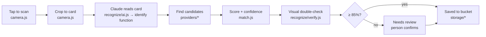
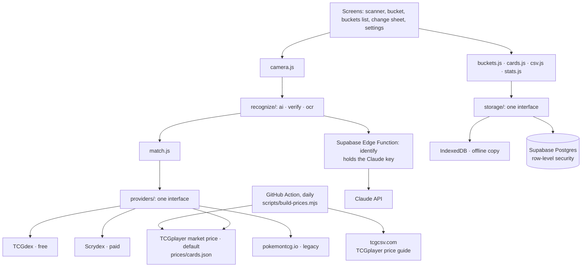

# Architecture

A static site (GitHub Pages) of small JavaScript modules, a Supabase backend for team data and secrets, and swappable price providers.

## Scan pipeline

## Components

## Module map

| Module | Job | Tested |
| --- | --- | --- |
| `scan.js` | The pipeline: read → match → double-check → done / review / failed | ✅ |
| `match.js` | Collector-number parsing, candidate scoring, confidence | ✅ |
| `livePrices.js` | Near Mint prices from the `tcg-price` function, mapped onto the card's versions only when clear | ✅ |
| `supabase/functions/tcg-price` | Asks TCGplayer for Near Mint market prices (≤50 cards, 4 at a time, 10-min cache) | ✅ handler tests |
| `search.js` | Typed search: every word matches name, set, set code or number prefix; ranking, sorts, recent searches | ✅ |
| `recognize/prompts.js`, `verify.js` | What Claude is asked; what a double-check verdict does to a match | ✅ |
| `recognize/ai.js` | Transports to Claude (on-phone key now, Edge Function in v0.3) | via `scan.js` |
| `cards.js` | Card shape helpers, printings (versions) | ✅ |
| `buckets.js` | Market, offer, profit, offer ↔ % calculator; review cards excluded | ✅ |
| `csv.js` | Export and import | ✅ |
| `stats.js` | Accuracy per reader from real use | ✅ |
| `providers/*` | Price sources behind one contract; `tcgplayer.js` searches the daily price file in memory | ✅ |
| `scripts/build-prices.mjs` | Daily: TCGplayer price guide → `prices/cards.json` (market price only) | ✅ via `tcgplayer-data.js` + fake-server run |
| `storage/*` | IndexedDB now, Supabase in v0.3 | browser run |
| `recognize/ocr.js`, `camera.js`, `ui/*`, `main.js` | Text reader, camera, screens (`ui/search.js`: the search screen) | browser run |

## Data model

See [`supabase/migrations/0001_init.sql`](../supabase/migrations/0001_init.sql): `teams`, `team_members`, `buckets`, `items`, plus a private `scans` Storage bucket. Every table has row-level security: a user only sees rows for teams they belong to.
